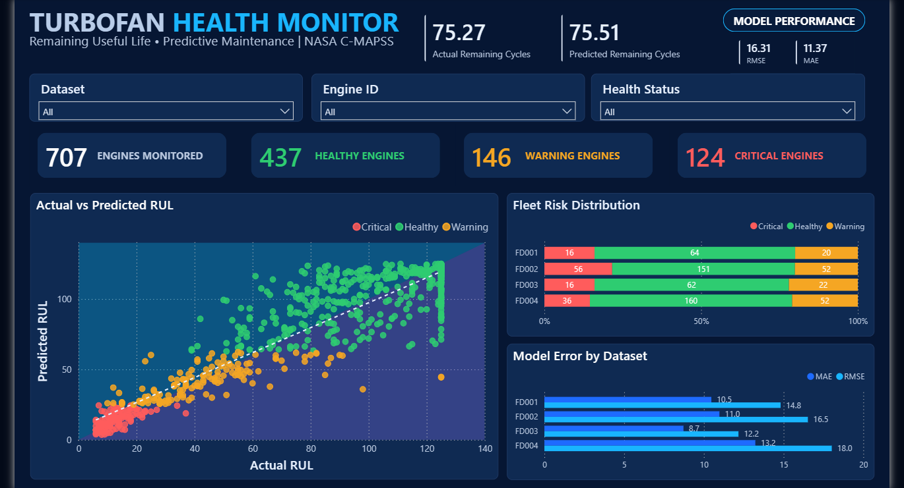

# 📊 NASA C-MAPSS – Interactive RUL Dashboard

Explore the interactive Power BI dashboard for the NASA Turbofan Engine Remaining Useful Life (RUL) Prediction project.

## 🚀 Live Interactive Dashboard

[**Click Here to Explore the Interactive Dashboard**](https://app.powerbi.com/view?r=eyJrIjoiYmNiMWFmN2QtNmUwMy00MjQ2LWJmYTktY2EyMzE2OWRmNThjIiwidCI6ImNmNzIyMWNkLTNiYzYtNDEwMS04NzYyLTU0ZjQ0ZjNiYzg5YSIsImMiOjl9)

## Dashboard Preview

## Key Features

- Actual vs. Predicted Remaining Useful Life (RUL).
- Engine health monitoring.
- Fleet risk distribution across datasets FD001–FD004.
- Model prediction error analysis.
- Interactive filters for dataset, engine ID, and health status.

## Technology

- Power BI
- SQL Server
- Python
- LSTM / BiLSTM
- NASA C-MAPSS Dataset
