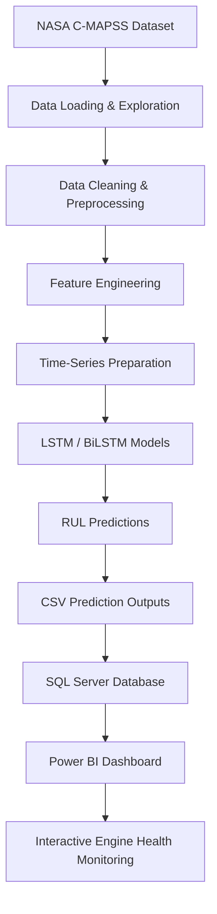
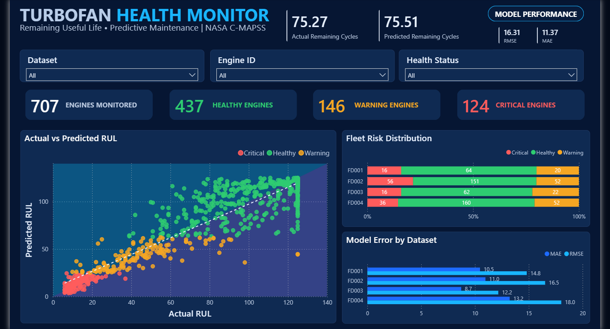

# ✈️ NASA C-MAPSS | Aircraft Engine Remaining Useful Life Prediction

### Deep Learning-Based Predictive Maintenance Using LSTM & BiLSTM

An end-to-end predictive maintenance project focused on estimating the Remaining Useful Life (RUL) of aircraft turbofan engines using NASA C-MAPSS sensor data, deep learning models, SQL Server, and Power BI.

The project combines time-series analysis, LSTM-based predictive modeling, database integration, and interactive business intelligence visualization to support proactive engine maintenance and reduce unexpected failures.

---

## 📌 Project Overview

Aircraft engines operate under complex conditions and experience gradual performance degradation over time. Unexpected engine failures can lead to significant operational costs, maintenance expenses, and safety risks.

Traditional maintenance strategies may rely on fixed schedules or reactive interventions. Predictive maintenance offers a data-driven alternative by analyzing historical sensor readings and estimating how many operational cycles remain before an engine reaches its end of useful life.

This project develops a Remaining Useful Life (RUL) prediction system using deep learning models trained on the NASA C-MAPSS turbofan engine dataset.

The predicted results are then integrated into SQL Server and presented through an interactive Power BI dashboard for monitoring engine health and analyzing model performance.

---

## 🎯 Project Objectives

- Predict the Remaining Useful Life (RUL) of aircraft turbofan engines.
- Analyze multivariate time-series sensor data.
- Investigate engine degradation patterns across different operating conditions.
- Develop and evaluate LSTM and BiLSTM deep learning models.
- Compare prediction performance across four NASA C-MAPSS datasets.
- Store actual and predicted RUL results in SQL Server.
- Build an interactive Power BI dashboard for engine health monitoring.
- Transform machine learning predictions into actionable maintenance insights.

---

## 🗂️ Dataset Description

The project uses the NASA Commercial Modular Aero-Propulsion System Simulation (C-MAPSS) dataset.

C-MAPSS contains simulated turbofan engine run-to-failure data, including operational settings and sensor measurements collected throughout engine life cycles.

### Dataset Configurations

The project covers all four subsets:

| Dataset | Operating Conditions | Fault Conditions |
|---|---|---|
| FD001 | Single | One |
| FD002 | Six | One |
| FD003 | Single | Two |
| FD004 | Six | Two |

Each subset introduces different operating conditions and degradation patterns, allowing the models to be evaluated under varying levels of complexity.

### Dataset Components

- Training Data: Sensor readings recorded throughout the engines' operational life until failure.
- Testing Data: Partial operational histories used for RUL prediction.
- RUL Labels: Actual Remaining Useful Life values used for evaluating predictions.
- Operational Settings: Variables describing engine operating conditions.
- Sensor Measurements: Multivariate time-series readings reflecting engine behavior.

---

## ⚙️ Project Architecture

The solution follows an end-to-end machine learning and analytics workflow.



### Workflow Explanation

**1. Data Acquisition**

Load the four NASA C-MAPSS datasets and examine their structure, sensor readings, operating conditions, and RUL labels.

**2. Exploratory Data Analysis**

Investigate sensor behavior, engine degradation trends, feature distributions, and relationships between operational cycles and sensor measurements.

**3. Data Preprocessing**

Clean and prepare the time-series data, perform the required transformations, and organize the observations into sequences suitable for deep learning.

**4. Deep Learning Modeling**

Train LSTM and BiLSTM models to learn temporal dependencies in engine sensor measurements and estimate Remaining Useful Life.

**5. Prediction and Evaluation**

Generate RUL predictions and compare them against actual RUL values using regression evaluation metrics.

**6. Database Integration**

Export prediction results to CSV files and integrate the outputs into SQL Server for structured storage and analytical querying.

**7. Business Intelligence**

Connect Power BI to the stored results and develop an interactive dashboard for monitoring engine health and analyzing predictive performance.

---

## 🧠 Deep Learning Models

The project investigates two recurrent neural network architectures:

### Long Short-Term Memory (LSTM)

LSTM is a recurrent neural network architecture designed to learn long-term dependencies in sequential data.

It is particularly useful for analyzing engine sensor measurements over multiple operational cycles.

### Bidirectional Long Short-Term Memory (BiLSTM)

BiLSTM processes sequential information in both forward and backward directions, allowing the model to learn temporal patterns from both directions within the input sequence.

### Model Implementation

Separate notebooks are provided for the four dataset configurations:

| Dataset | Model |
|---|---|
| FD001 | BiLSTM |
| FD002 | BiLSTM |
| FD003 | LSTM |
| FD004 | LSTM |

Each notebook contains the corresponding dataset processing, model development, training, prediction, and evaluation workflow.

---

## 📈 Model Evaluation

Model performance is evaluated by comparing actual RUL values against predicted RUL values.

The evaluation includes:

- Mean Absolute Error (MAE)
- Root Mean Squared Error (RMSE)
- Actual vs. Predicted RUL Analysis
- Prediction Error Analysis

### Dashboard Performance Indicators

The current Power BI dashboard reports the following overall indicators:

| Evaluation Metric | Value |
|---|---:|
| MAE | 11.37 |
| RMSE | 16.31 |
| Actual Remaining Cycles | 75.27 |
| Predicted Remaining Cycles | 75.51 |

These are the aggregate values currently displayed in the dashboard and should be interpreted according to its active filters and underlying data.

---

## 📊 Interactive Power BI Dashboard

### Turbofan Health Monitor

The project includes an interactive Power BI dashboard designed to transform model predictions into meaningful engine health insights.

### Dashboard Preview



### Live Interactive Dashboard

Explore the complete interactive report:

**[🚀 OPEN POWER BI DASHBOARD](https://app.powerbi.com/view?r=eyJrIjoiYmNiMWFmN2QtNmUwMy00MjQ2LWJmYTktY2EyMzE2OWRmNThjIiwidCI6ImNmNzIyMWNkLTNiYzYtNDEwMS04NzYyLTU0ZjQ0ZjNiYzg5YSIsImMiOjl9)**

### Dashboard Capabilities

**1. Fleet Health Monitoring**

Monitor the distribution of engines across different health conditions:

- Healthy Engines
- Warning Engines
- Critical Engines

**2. Actual vs. Predicted RUL**

Visualize the relationship between actual and predicted Remaining Useful Life values.

**3. Fleet Risk Distribution**

Analyze engine health status across FD001, FD002, FD003, and FD004.

**4. Model Error Analysis**

Compare MAE and RMSE across the four dataset configurations.

**5. Interactive Filtering**

Explore the dashboard using filters for:

- Dataset
- Engine ID
- Health Status

### Fleet Monitoring Overview

The current dashboard displays:

| Indicator | Value |
|---|---:|
| Engines Monitored | 707 |
| Healthy Engines | 437 |
| Warning Engines | 146 |
| Critical Engines | 124 |

---

## 🗄️ Database Integration

SQL Server is used as the database layer to store and organize the model prediction results.

The integration workflow transfers the generated prediction outputs from Python into a relational database, making the results available for further analysis and visualization.

### Database Workflow

```text
Python Model Predictions
          |
          v
      CSV Outputs
          |
          v
      SQL Server
          |
          v
    Analytical Queries
          |
          v
      Power BI
```

The SQL setup script is provided in:

`EngineRUL_SETUP.sql`

It contains the database setup and SQL definitions used in the project.

---

## 🛠️ Technologies & Tools

| Category | Technologies |
|---|---|
| Programming Language | Python |
| Data Processing | Pandas, NumPy |
| Data Visualization | Matplotlib, Seaborn |
| Machine Learning | Scikit-learn |
| Deep Learning | TensorFlow / Keras |
| Neural Network Models | LSTM, BiLSTM |
| Database | Microsoft SQL Server |
| Data Storage | CSV |
| Business Intelligence | Microsoft Power BI |
| Development Environment | Jupyter Notebook |
| Dataset | NASA C-MAPSS |

---

## 📁 Repository Structure

```text
NASA-CMAPSS-RUL-Prediction/
│
├── README.md
│
├── Dashboard/
│   ├── README.md
│   └── dashboard_preview.png
│
├── Documentation.pdf
│
├── EngineRUL_SETUP.sql
│
├── FD001_BILSTM_RUL.ipynb
├── FD002_BILSTM_RUL.ipynb
├── FD003_LSTM_RUL.ipynb
└── FD004_LSTM_RUL.ipynb
```

---

## 🚀 Getting Started

### Prerequisites

Before running the notebooks, make sure you have:

- Python 3.x
- Jupyter Notebook
- Required Python libraries
- NASA C-MAPSS dataset files
- Microsoft SQL Server (for database integration)
- Power BI Desktop (for dashboard exploration)

### Installation

Clone the repository:

```bash
git clone https://github.com/0Mariam-Salem0/NASA-CMAPSS-RUL-Prediction.git
```

Navigate to the project directory:

```bash
cd NASA-CMAPSS-RUL-Prediction
```

Install the required Python libraries:

```bash
pip install numpy pandas matplotlib seaborn scikit-learn tensorflow jupyter sqlalchemy pyodbc
```

### Running the Project

1. Download and prepare the NASA C-MAPSS dataset files.
2. Place the dataset files in the appropriate data directory.
3. Open Jupyter Notebook.
4. Run the notebooks corresponding to FD001, FD002, FD003, and FD004.
5. Generate and export the prediction results.
6. Execute the SQL setup script in SQL Server.
7. Load the prediction results into the database.
8. Connect Power BI to the database and explore the dashboard.

---

## 📄 Project Documentation

Detailed project documentation is available here:

[View Project Documentation](Documentation.pdf)

The documentation provides additional information about the project methodology, implementation, and results.

---

## 🔮 Future Improvements

Potential directions for extending the project include:

- Hyperparameter optimization and systematic model comparison.
- Experimenting with additional sequence-learning architectures.
- Improving prediction accuracy across complex operating conditions.
- Implementing real-time engine health monitoring.
- Integrating streaming data pipelines for continuous predictive maintenance.
- Developing automated maintenance alerts based on predicted RUL.

---

## 🔑 Key Takeaways

This project demonstrates an end-to-end predictive maintenance workflow that combines:

- Multivariate time-series analysis.
- Deep learning-based RUL prediction.
- LSTM and BiLSTM model development.
- Structured database integration.
- Interactive business intelligence reporting.

By connecting machine learning predictions with SQL Server and Power BI, the project demonstrates how predictive analytics can support data-driven aircraft engine maintenance decisions.
